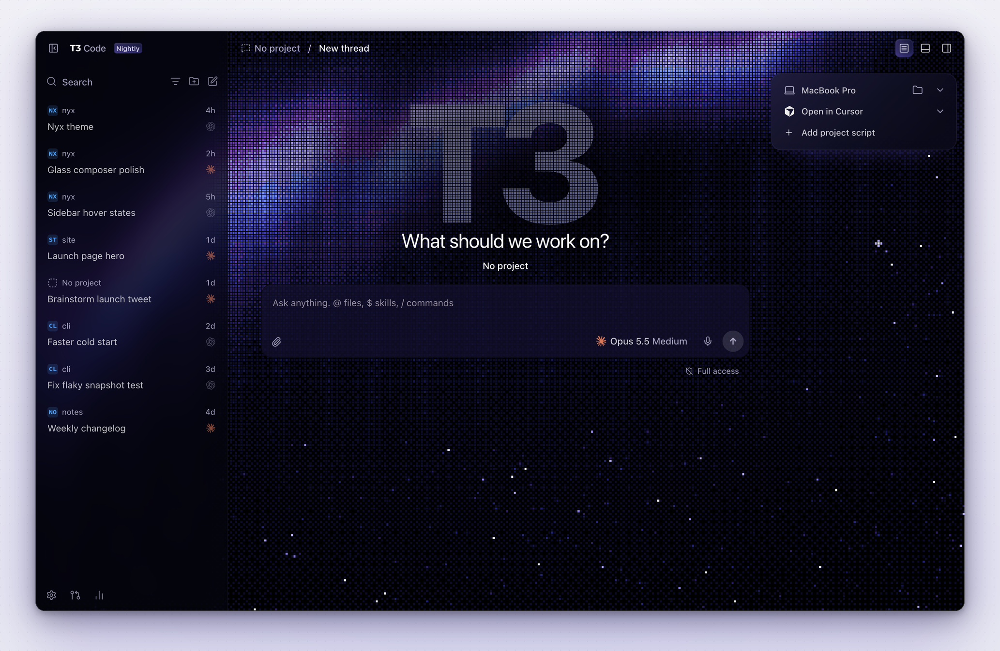
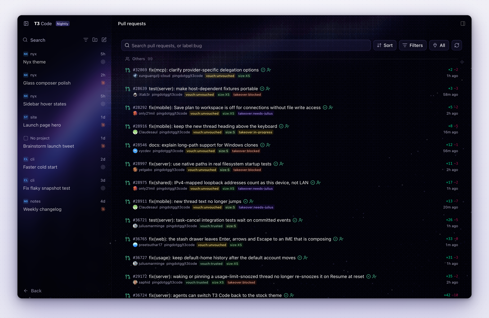
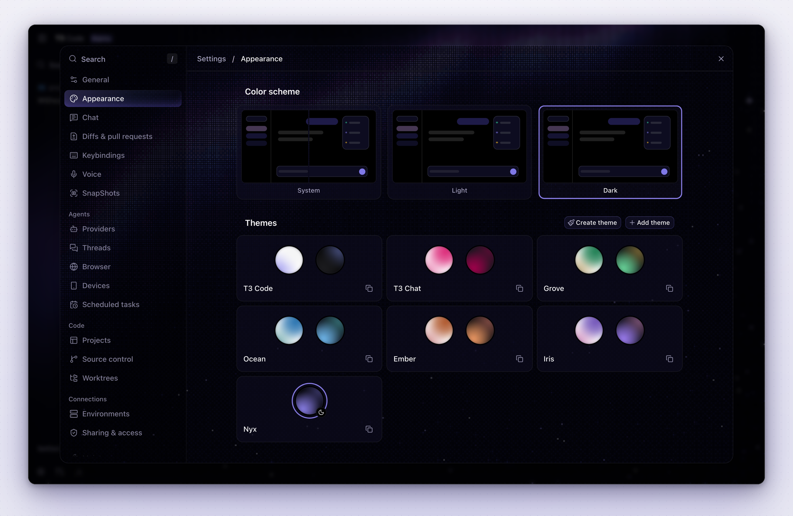
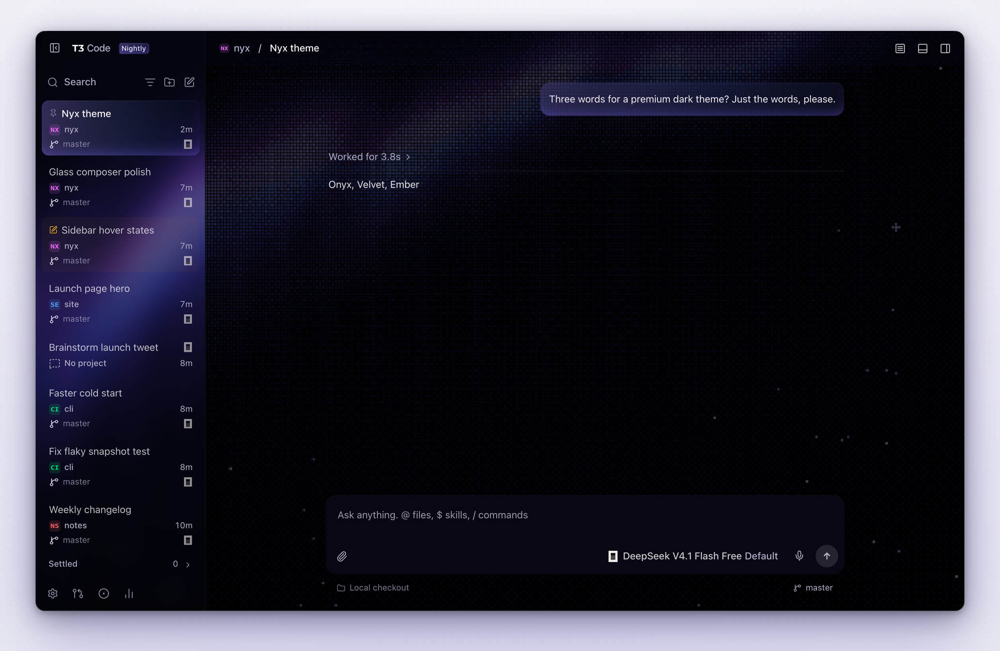
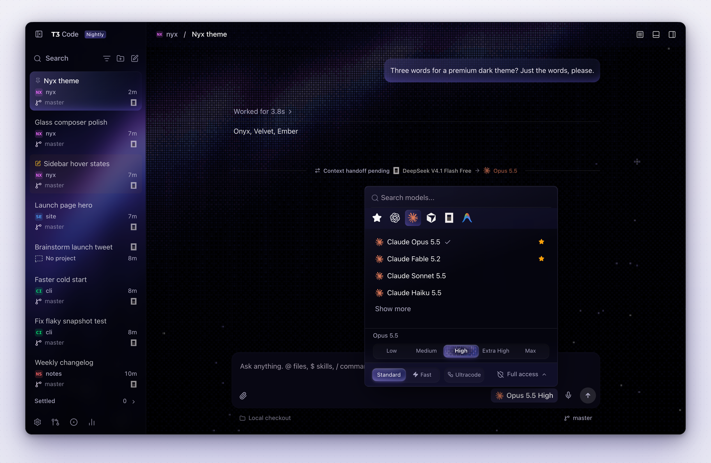

# Nyx

A night-sky theme for [T3 Code](https://t3.codes). The background is a starry sky with a purple aurora drawn as tiny glowing LED dots. Menus and panels stay translucent like the default T3 look.




<details>
<summary>More screenshots</summary>






</details>

## Nyx and Nyx Plus

This repo includes two themes. You can install one or both and switch between them in the T3 theme picker.

- **Nyx** changes only colors and the background.
- **Nyx Plus** uses the same sky and adds two layout changes.
  - **Title-first sidebar rows.** Each row shows the thread title first, then the project and status, then the branch. Pinned and draft markers sit before the title.
  - **Compact model picker.** Search sits on top, followed by provider icons, the model list, and sliding glass keys for effort. Effort keys hide for models that do not use them. Fast is a single on/off key, and favorite stars glow lavender.




## Install

Download the theme file and apply it with the `t3` CLI.

Install Nyx:

```sh
curl -fsSL https://raw.githubusercontent.com/Deepusleepy/t3-nyx-theme/main/nyx.json -o nyx.json
t3 theme set nyx.json
```

Install Nyx Plus:

```sh
curl -fsSL https://raw.githubusercontent.com/Deepusleepy/t3-nyx-theme/main/nyx-plus.json -o nyx-plus.json
t3 theme set nyx-plus.json
```

T3 applies the theme right away in both the desktop app and the browser. If you install both, the last one you set becomes active. To go back to the default theme, pick another theme in the theme picker or run `t3 theme set t3-chat`.

### Install with an agent

Paste this into a T3 Code thread:

> Install a theme from https://github.com/Deepusleepy/t3-nyx-theme. Follow the "Instructions for agents" section of its README.

Your agent will ask whether you want Nyx, Nyx Plus, or both. Name your choice in the message to skip the question.

### Instructions for agents

1. This repo has two themes. **Nyx** changes only colors and the background. **Nyx Plus** keeps the same sky and adds title-first sidebar rows and a compact model picker. Both can be installed side by side.
2. Unless the user already said "Nyx Plus", "plain Nyx", or "both", ask which they want. Saying "the Nyx theme" alone is not a choice, so ask. If they want both, ask which one to make active now.
3. Download each chosen file from `https://raw.githubusercontent.com/Deepusleepy/t3-nyx-theme/main/nyx.json` and `https://raw.githubusercontent.com/Deepusleepy/t3-nyx-theme/main/nyx-plus.json`.
4. If the `t3` command is available, run `t3 theme set <path>` for each file. Otherwise call the `t3_theme_set` tool with `themeId` set to `"nyx"` or `"nyx-plus"` and the file JSON as `theme`.
5. Each install switches T3 to that theme, so install the theme the user wants active last.
6. Do not edit the JSON files. Both are close to T3's CSS size limit for themes.

## Requirements

- T3 Code Nightly (November 2026 or later).
- Desktop app or browser. The phone app does not use themes.

## Notes

- Nyx is dark only. It stays dark even when your system is in light mode.
- Panel translucency follows the **Glass opacity** slider in **Settings > Appearance**. Around 40% works best and matches the screenshots.
- The sky background scales to any window size.
- If a future T3 update changes its layout, affected touches fall back to T3's default look without breaking the app.

## Build it yourself

`theme.css` holds the shared styles, `plus.css` adds the Nyx Plus layout, `art.py` generates the sky, and `build.py` bundles them into `nyx.json` and `nyx-plus.json`.

```sh
python3 -m venv .venv
.venv/bin/pip install -r requirements.txt
.venv/bin/python build.py
```

## License

[MIT](LICENSE)
