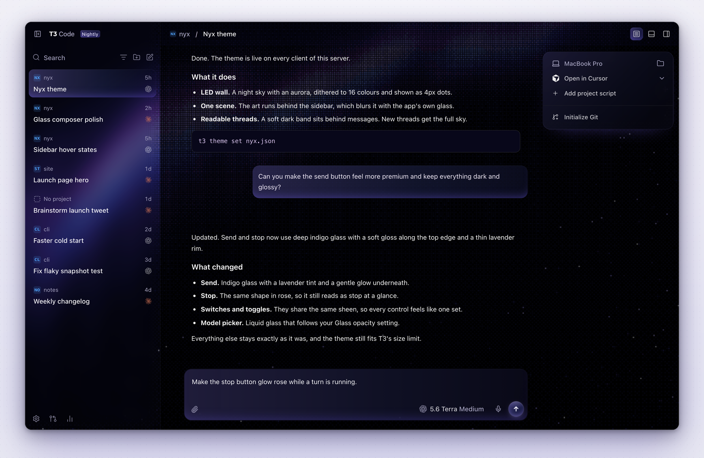
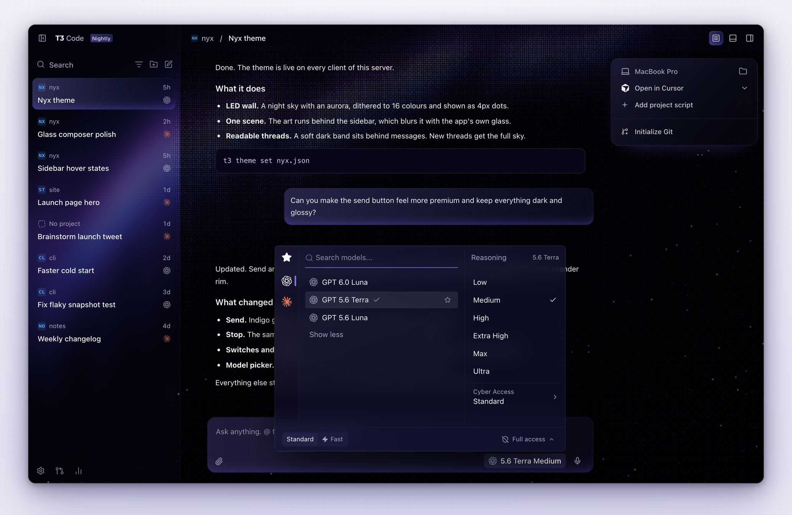
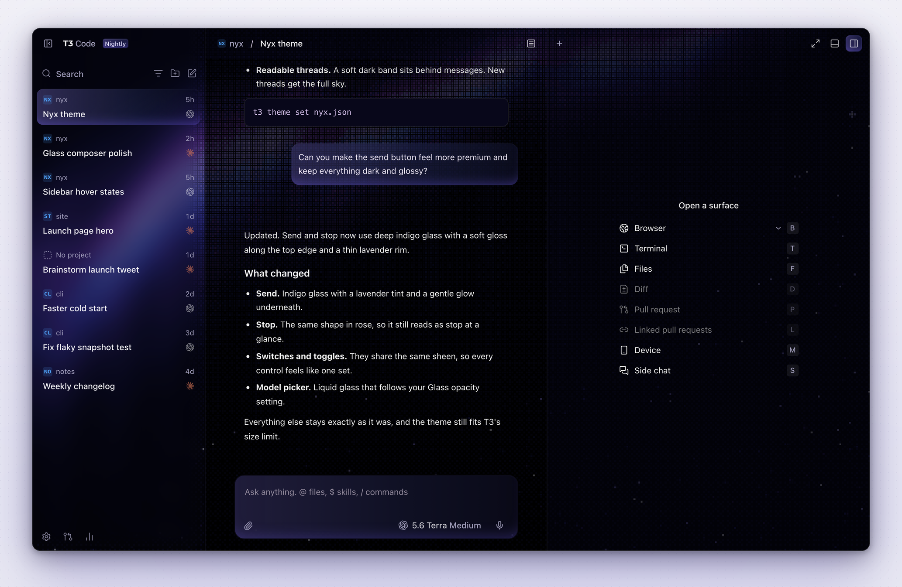
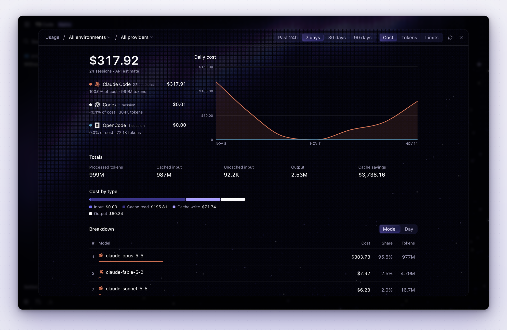

# Nyx

A night-sky theme for [T3 Code](https://t3.codes). The background is a starry sky with a purple aurora, drawn as tiny glowing dots like an LED screen. Menus and panels stay see-through like the default T3 look.









## Install

```sh
curl -fsSL https://raw.githubusercontent.com/Deepusleepy/t3-nyx-theme/main/nyx.json -o nyx.json
t3 theme set nyx.json
```

T3 switches to Nyx right away, in the desktop app and in the browser. To go back, pick another theme in the theme picker or run `t3 theme set t3-chat`.

### Let your agent install it

Paste this into a T3 Code thread:

> Install the Nyx theme from https://github.com/Deepusleepy/t3-nyx-theme. Follow the "Instructions for agents" section of its README.

### Instructions for agents

1. Download `https://raw.githubusercontent.com/Deepusleepy/t3-nyx-theme/main/nyx.json`.
2. If the `t3` command is available, run `t3 theme set <path to nyx.json>`.
3. Otherwise call the `t3_theme_set` tool with `themeId: "nyx"` and the file's JSON as `theme`.
4. Do not edit the file. It is close to the size limit T3 allows for themes.

## Requirements

- A recent T3 Code Nightly (November 2026 or later).
- Works in the desktop app and the browser. The phone app doesn't use themes.

## Notes

- Nyx is dark only. It keeps T3 dark even when your computer is in light mode.
- The see-through look follows the Glass opacity slider in Settings › Appearance. It looks best at around 40%, which is what the screenshots use.
- The sky fills the window at any size.
- If a future T3 update changes its layout, a few small touches may fall back to T3's normal look. Nothing breaks.

## Change the theme yourself

`theme.css` holds the styles, `art.py` draws the sky, and `build.py` puts them together into `nyx.json`.

```sh
python3 -m venv .venv
.venv/bin/pip install -r requirements.txt
.venv/bin/python build.py
```

## License

[MIT](LICENSE)
