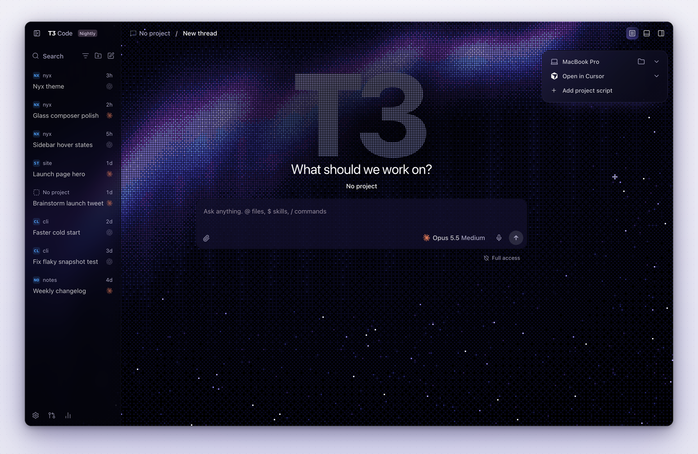
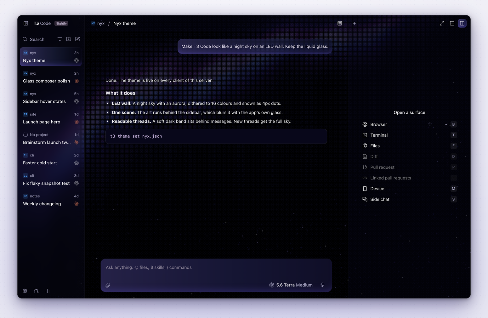

# Nyx

A night-sky theme for [T3 Code](https://t3.codes). The sky is drawn as a dithered LED wall, with an aurora and twinkling stars. The sidebar, composer and popups keep T3's liquid glass.




## Install

```sh
curl -fsSL https://raw.githubusercontent.com/Deepusleepy/t3-nyx-theme/main/nyx.json -o nyx.json
t3 theme set nyx.json
```

Every web and desktop client of that T3 server switches to Nyx. To go back, pick another theme in the theme picker or run `t3 theme set t3-chat`.

### Let your agent install it

Paste this into a T3 Code thread:

> Install the Nyx theme from https://github.com/Deepusleepy/t3-nyx-theme. Follow the "Instructions for agents" section of its README.

### Instructions for agents

1. Download `https://raw.githubusercontent.com/Deepusleepy/t3-nyx-theme/main/nyx.json`.
2. If the `t3` command is available, run `t3 theme set <path to nyx.json>`.
3. Otherwise call the `t3_theme_set` tool with `themeId: "nyx"` and the file's JSON as `theme`.
4. Do not edit the file. Its CSS is close to T3's 20,000-character limit.

## Requirements

- T3 Code with theme CSS support (Nightly from November 2026 onward).
- Desktop or web client. T3's mobile app does not use themes.

## Notes

- Nyx is dark only. It keeps T3 dark even when your system is in light mode.
- The frosted sidebar follows the Glass opacity setting in Settings › Appearance. At 100% it is solid.
- The art is a 480×270, 16-colour PNG embedded in the theme. On windows larger than 1920×1080 the dots scale up so the sky still fills the window.
- A few rules use parts of T3's layout that are not on its list of stable selectors. If a release renames them, those parts fall back to T3's default look. Nothing else breaks.

## Build from source

`theme.css` is the readable source. `art.py` draws and dithers the sky. `build.py` minifies the CSS, embeds the art and checks the result fits T3's limit.

```sh
python3 -m venv .venv
.venv/bin/pip install -r requirements.txt
.venv/bin/python build.py
```

## License

[MIT](LICENSE)
